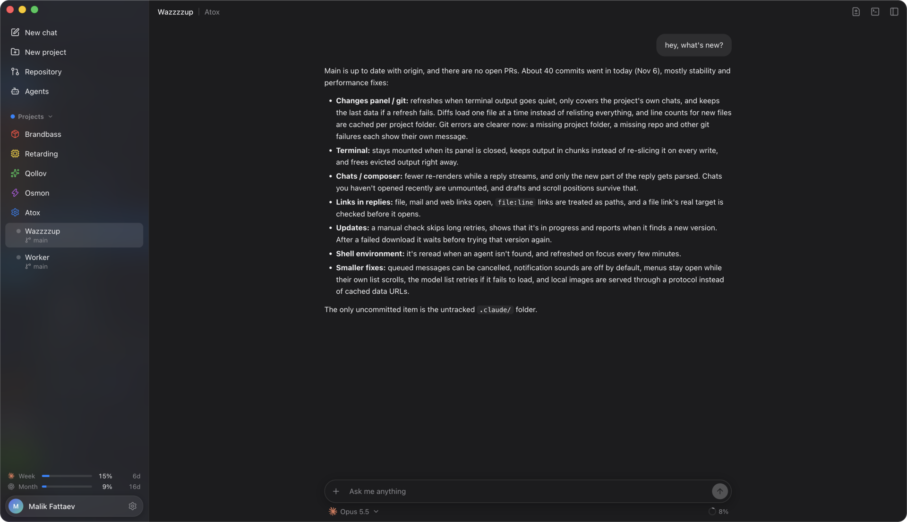

<p align="center">
  
</p>

<p align="center">
  <strong>Every coding agent in one window</strong><br>
  <sub>A lightweight Mac and Linux app for Claude Code, Codex and other coding agents.</sub>
</p>

<p align="center">
  <a href="https://github.com/malikfattaev/Atox/releases/latest"></a>
  
  <a href="https://github.com/malikfattaev/Atox/actions/workflows/release.yml"></a>
  
  
  <a href="LICENSE"></a>
</p>

<p align="center">
  <a href="https://github.com/malikfattaev/Atox/releases/latest"><strong>Download</strong></a>
  &nbsp;&middot;&nbsp;
  <a href="#install"><strong>Install</strong></a>
  &nbsp;&middot;&nbsp;
  <a href="#what-it-does"><strong>Features</strong></a>
  &nbsp;&middot;&nbsp;
  <a href="https://github.com/malikfattaev/Atox/issues"><strong>Issues</strong></a>
</p>

<p align="center">
  
</p>

## What it does

- **Any agent, any moment.** Claude Code, Codex and more in one chat. Switch whenever you like.
- **Agents team up.** Claude can ask Codex for a review, and the answer comes back to the same chat.
- **Real terminals.** Every chat is a shell in your project folder, nothing is hidden.
- **Projects and spaces.** A project is a folder, its chats live inside.
- **Updates itself.** A new version is one click away.

## Install

**Mac:** download the `.dmg` from the [latest release](https://github.com/malikfattaev/Atox/releases/latest) (`arm64` for Apple Silicon, `x64` for Intel) and drag Atox to Applications.
The first time, macOS says it can't verify the developer: open System Settings → Privacy & Security and click "Open Anyway". Only once.

**Linux:** grab the `.AppImage` (any distro) or the `.pacman` (Arch) from the same release.

```bash
chmod +x Atox-*.AppImage && ./Atox-*.AppImage
```

## Privacy

Atox sends anonymous usage stats to [Aptabase](https://aptabase.com) so we know how many people use it: an install event once, then one event per day, week and month the app is open. Each event carries only the app version, OS name and version, and locale. No IDs, projects, files, chats or IP addresses are stored.

Turn it off any time in Settings → Privacy.

## License

[MIT](LICENSE) © Malik Fattaev
